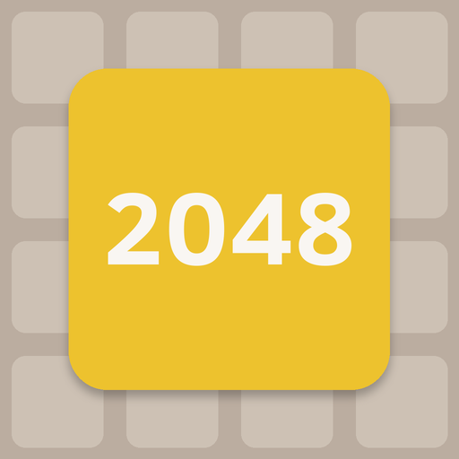
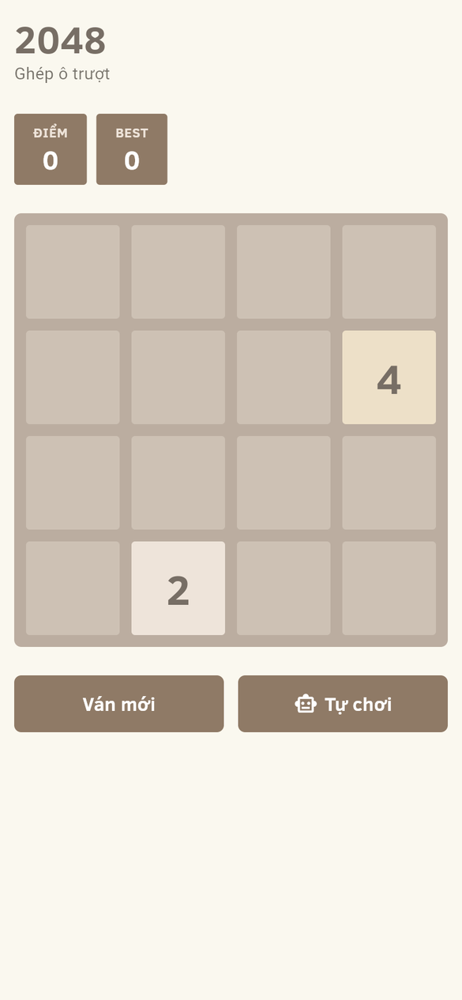
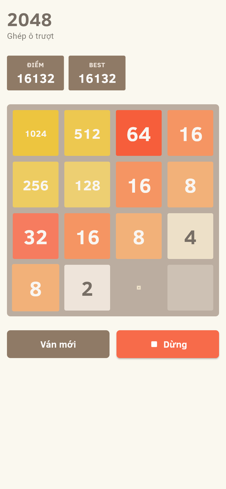
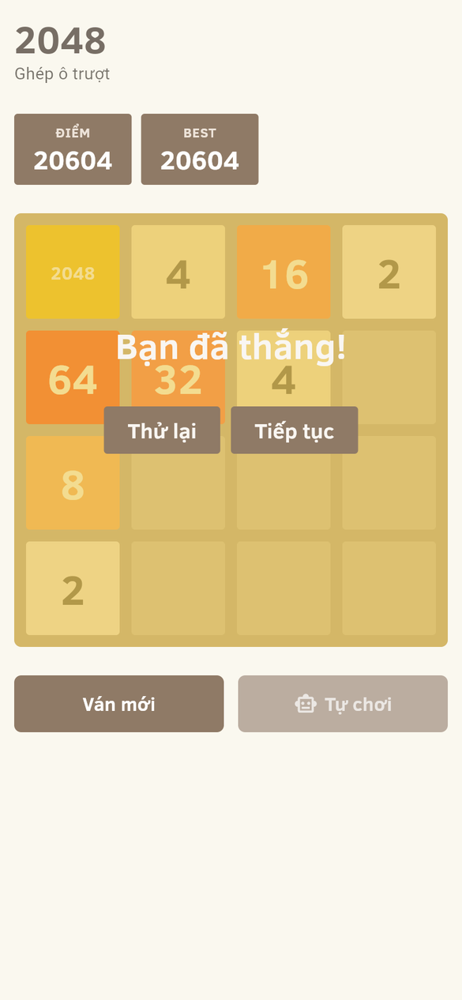

  

<h1 align="center">2048</h1>

  Trượt, ghép, nhân đôi: đi đến ô 2048 và xa hơn nữa. 
  Chơi được trên Android, iOS và Web, giao diện tiếng Việt và tiếng Anh.

  
  &nbsp;
  
  &nbsp;
  

## Giới thiệu

Bàn chơi 4×4 bắt đầu với hai ô số. Mỗi lần bạn vuốt, mọi ô trượt hết về một
phía; hai ô **cùng số** chạm nhau sẽ gộp thành một ô có giá trị gấp đôi
(2 + 2 → 4, 4 + 4 → 8, …). Sau mỗi lượt, một ô 2 hoặc 4 mới xuất hiện ở chỗ trống.

Mục tiêu là tạo ra ô **2048** trước khi bàn bị lấp kín. Đạt 2048 rồi vẫn có thể
chơi tiếp để săn 4096, 8192…

## Tính năng

- 🧩 **Lối chơi 2048 cổ điển**: điều khiển bằng thao tác vuốt, ô mới và ô vừa
  gộp có hiệu ứng nảy.
- 📈 **Điểm và kỷ lục**: theo dõi điểm hiện tại và điểm cao nhất (Best).
- 💾 **Tự lưu ván chơi**: thoát app giữa chừng, mở lại vẫn chơi tiếp đúng ván đang dở.
- 🏁 **Chơi vượt 2048**: khi đạt 2048, chọn *Tiếp tục* để chơi tiếp hoặc
  *Thử lại* để bắt đầu ván mới.
- 🤖 **Chế độ tự chơi**: bấm *Tự chơi* để xem AI tự giải. AI tính trước các
  nước đi và khả năng ô mới xuất hiện, gần như ván nào cũng đạt 2048.
- 🌐 **Song ngữ**: giao diện tự đổi theo ngôn ngữ của máy (tiếng Việt / tiếng Anh).

## Cách chơi

| Thao tác | Kết quả |
| --- | --- |
| Vuốt lên / xuống / trái / phải | Mọi ô trượt về hướng đó, hai ô cùng số chạm nhau thì gộp lại |
| Gộp hai ô | Giá trị ô mới được cộng vào điểm |
| Nút **Tự chơi** | Máy tự chơi; bấm **Dừng** hoặc tự vuốt để lấy lại quyền điều khiển |
| Nút **Ván mới** | Bắt đầu lại từ đầu |

- **Thắng** khi tạo được ô 2048.
- **Thua** khi bàn kín ô và không còn hai ô cạnh nhau nào cùng số.

**Mẹo:** giữ ô lớn nhất ở một góc và hạn chế vuốt theo hướng kéo nó ra khỏi góc đó.
